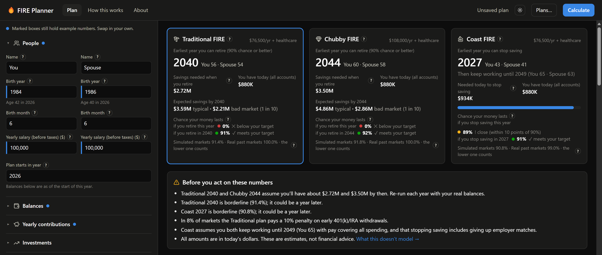
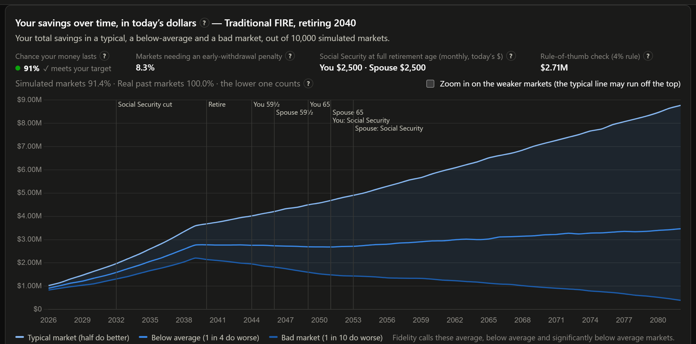

# FIRE Planner

A retirement planner built around one household's situation: a US married couple filing jointly, with
401(k)/IRA, Roth and HSA accounts and Social Security, who want a retirement with room to enjoy it. It is
published as is, not as a calculator for everyone, and it is not financial advice.

**Open it: https://malvinly.github.io/fire/**. It runs entirely in your browser; nothing you enter is sent anywhere.



## What it tells you

| FIRE type | Answer |
|---|---|
| **Traditional FIRE** | The earliest year both of you can stop working, and the savings you need by then. |
| **Chubby FIRE** | The same, at a higher spending level (default 1.2 × today's spending). |
| **Coast FIRE** | The earliest year you can stop saving and keep working until 65, with your pay covering spending. |

Each answer is the earliest year with at least a **90% chance** your money lasts until the younger of you
turns 96. 90% is the confidence level Fidelity's FI Planner uses.

## How it tests a plan

- **Two tests, and the lower result counts:** 10,000 simulated markets built from real US market history
  (1871–2025), and every real stretch of that history replayed in order.
- **Year by year:** contributions while working; then spending, healthcare before and after Medicare, Social
  Security from your earnings record (cut when the trust fund runs short), Roth conversions, 59½ rules,
  required withdrawals, and federal and state taxes.
- **A mix that changes with age:** by default Vanguard's Target Retirement glide path; or Fidelity's fixed
  70/25/5, or your own.



The app's **How this works** page lists every assumption behind the numbers on screen, whether it's a default
or yours, and its source.

## Built for one household

Three kinds of FIRE are left out on purpose:

- **Lean FIRE**: a bare-bones budget. This planner is for a retirement with travel and eating out.
- **Fat FIRE**: a luxury budget paid for by years of aggressive saving. The tradeoff here is enjoying money
  along the way.
- **Barista FIRE**: depends on part-time work. Here every plan stands on savings and Social Security alone.

It also doesn't model one spouse dying first, separate retirement years, ACA subsidies, IRMAA or
state-by-state tax rules. The full list is under "What this doesn't model" in **How this works**.

## Yearly checkup

1. Open last year's plan (**Plans…**) and choose *Save as new* (for example "2027 checkup").
2. Click **Start plan in 2027** on the banner.
3. Update balances, salaries and contributions.
4. Press **Calculate**.

If the app's data or calculator is newer than a plan's results, a banner says so, and the old results stay
until you press **Recalculate**.

## Your data

No accounts, cookies or analytics. The plan on screen is kept in your browser between visits. **Plans…**
saves plan files to a folder you choose (Chrome or Edge; other browsers download and open them instead). Plan
files hold your financial details, so keep them somewhere private. On a shared computer, choose
**Plans…** → *Start over* when you're done.

## Run it yourself

Needs [Node.js](https://nodejs.org/) 22.18 or newer.

```bash
npm install
npm run dev
```

Open http://localhost:5391. For a copy that runs without Node.js, run `npm run build` and double-click
`Start FIRE Planner.cmd` in `dist/`. See [A permanent local copy](docs/DEVELOPMENT.md#a-permanent-local-copy).

## Docs

- [DEVELOPMENT.md](docs/DEVELOPMENT.md): setup, tests, the local copy, the yearly data update
- [DESIGN.md](docs/DESIGN.md): what the calculator does and how each result is defined
- [DECISIONS.md](docs/DECISIONS.md): every assumption and judgement call, and where to change it
- [pending-features.md](docs/pending-features.md): planned work

## License

[MIT](LICENSE). Favicon: "Fire" from [Fluent Emoji](https://github.com/microsoft/fluentui-emoji), © Microsoft
Corporation, MIT License. Section and card icons from [Lucide](https://lucide.dev), © Lucide Contributors, ISC
License.
